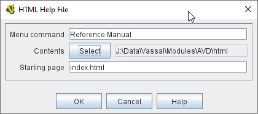
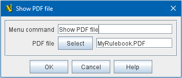
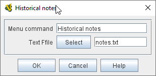
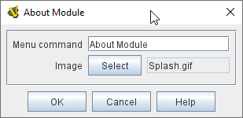
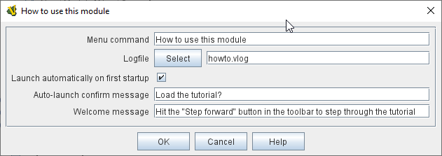

== VASSAL Reference Manual
[#top]

[.small]#<<index.adoc#toc,Home>> > <<GameModule.adoc#top,Module>> > *Help Menu*#

'''''

=== Help Menu

The "Help" menu in the main control window contains general help files for VASSAL.
You may add more help files specific to the module you are creating by right-clicking on the _[Help Menu]_ component in the Editor and selecting the appropriate _Add_ option.

This can also be used to include a PDF file, e.g.
of a rulebook, in your module (see <<#PDF,Using PDF Files>> , below).

'''''

=== Sub-Components

[#HtmlHelpFile]
==== HTML Help File

Adds an entry to the help menu.
Selecting the menu item opens an external browser on the user's machine with HTML content that you specify.

[width="100%",cols="50%a,^50%a",]
|===
|
*Menu command:*::  The text of the About item at the end of the Help menu on Windows and Linux (for example, "About My Game"). If left blank, or left as the default "About Module", "About" followed by the module name is used. On macOS the application menu names the item itself.

*Contents:*::  A folder on your local file system.
The contents of the folder will be copied into the module and expanded onto the user's machine when the user selects the menu item.
The folder can contain any number of sub-folders and can include image data, style sheets, etc.
Be sure that your HTML content makes use of relative URLs.

*Starting Page:*::  The file within the Contents folder that the user's browser will be pointed to.

NOTE: You can launch an external URL in the user's browser by specifying the URL as the Starting Page and leaving the Contents set to null.

|
|===

[#PDF]
==== PDF Help File
Adds an entry to the help menu. Selecting the menu item opens an external browser to view a specified PDF file.

[width="100%",cols="50%a,^50%a",]
|===
|
*Menu command*:::  The menu item to be added to the Help menu.

*PDF file*:::  A PDF file you select from your local file system. It will automatically be copied into the module and will be distributed with it.
|
|===

==== Plain Text Help File

Adds an entry to the Help menu in the main controls window.
Selecting the menu displays a new window with the contents of a plain text file.

[width="100%",cols="50%a,^50%a",]
|===
|
[#HelpFile]

*Menu command:*::  The text of the About item at the end of the Help menu on Windows and Linux (for example, "About My Game"). If left blank, or left as the default "About Module", "About" followed by the module name is used. On macOS the application menu names the item itself.

*Text file:*::  A file containing the contents of the window to be displayed.

| +
|===

[#AboutScreen]
==== About Screen (legacy)

From VASSAL 3.9, the About screen image is set on the <<GameModule.adoc#top,Module>> itself (*About screen image*), and this component can no longer be added.

Modules made with earlier versions may still contain an About Screen component.
Its image is still used, as long as the Module has no About screen image of its own, and still serves as the start-up wizard background.
Its *Menu command* is no longer used: VASSAL shows a single About entry, "About _module name_", at the top of the application menu on macOS and as the last item of the Help menu on Windows and Linux.
To move to the new arrangement, set the image on the Module and delete the About Screen component.

The About screen always shows the current version of the VASSAL engine, your module and any loaded extensions.

[width="100%",cols="50%a,^50%a",]
|===
|
*Menu command:*::  No longer used.

*Image:*::  The image to display, if the Module has no About screen image.

|
|===

[#Tutorial]
==== Tutorial

You may create a tutorial by writing a logfile and making it accessible from the help menu.

[width="100%",cols="50%a,^50%a",]
|===
|
*Menu command:*::  The menu item under the Help Menu

*Logfile:*::  The logfile that players will step through when they select the corresponding menu item.

*Launch automatically on first startup:*::  If selected, then players will automatically be prompted to run the tutorial the first time they load the module.

*Auto-launch confirm message:*::  The text in the yes/no dialog that is displayed to the player when they load the module for the first time.
Answering "yes" will load the tutorial logfile.

*Welcome message:*::  The message that displays in the chat log when the tutorial is loaded.

|
|===
